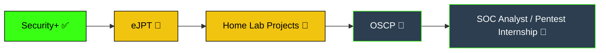

[README (1).md](https://github.com/user-attachments/files/30495531/README.1.md)
<div align="center">

<!-- Animated header banner -->


<!-- Typing animation -->
<a href="#">
  
</a>

<br/>


[](#)
[](#)
[](#)
[](#)

</div>

---

### `> cat about_me.txt`

```yaml
name:          Your Name
role:          Cybersecurity Student (Year 3) | Aspiring SOC Analyst / Pentester
location:      /home/earth
current_focus: [Network Security, Web App Pentesting, Digital Forensics, Malware Analysis]
learning:      [Cloud Security (AWS/Azure), Reverse Engineering, Purple Teaming]
fun_fact:      "I break things to learn how to build them safer."
```

<table>
<tr>
<td width="60%" valign="top">

### 🎯 Mission Briefing

I'm a third-year Cybersecurity student obsessed with the offense-defense duality of security — I spend my mornings hardening systems and my nights breaking into intentionally vulnerable ones. My goal is to become a well-rounded security engineer who understands infrastructure, code, and adversary behavior equally well.

- 🔐 Currently deep in **Offensive Security fundamentals** and **SOC operations**
- 🧠 Actively solving boxes on **HackTheBox / TryHackMe** and competing in **CTFs**
- 🛠️ Building home-lab projects around **detection engineering** and **network defense**
- 📡 Interested in **Threat Intelligence**, **Malware Analysis**, and **Cloud Security**
- 🎓 Pursuing certifications: `CompTIA Security+` → `eJPT` → `OSCP` (roadmap)

</td>
<td width="40%" valign="top">

```
┌─────────────────────────┐
│   THREAT MODEL: SELF     │
├─────────────────────────┤
│ Asset:      Curiosity    │
│ Vector:     Late nights  │
│ Mitigation: More coffee  │
│ Status:     UNPATCHED ☕ │
└─────────────────────────┘
```

</td>
</tr>
</table>

---

## 🛡️ Arsenal / Tech Stack

<div align="center">

**Offensive & Defensive Tooling**


**Languages & Scripting**


**Platforms & Infrastructure**


</div>

---

## ⚔️ Featured Operations (Projects)

<table>
<tr>
<td width="50%">

### 🕸️ Network Intrusion Detection Lab
Built a home SOC lab simulating enterprise traffic with **Suricata** + **ELK Stack** for real-time alerting and log correlation. Detects port scans, brute-force attempts, and C2 beaconing patterns.

`Python` `Suricata` `ELK` `Docker`

[**View Repo →**](#) &nbsp;|&nbsp; [**Write-up →**](#)

</td>
<td width="50%">

### 🐍 Automated Recon Framework
A modular Python tool that chains **Nmap**, **Subfinder**, and **Nikto** for automated attack-surface mapping, producing a clean HTML report per target.

`Python` `Bash` `Recon-ng` `Regex`

[**View Repo →**](#) &nbsp;|&nbsp; [**Write-up →**](#)

</td>
</tr>
<tr>
<td width="50%">

### 🔓 Vulnerable Web App (DVWA-style)
Designed and deployed an intentionally vulnerable Flask application (SQLi, XSS, IDOR, broken auth) used as a training range for peers in the campus security club.

`Flask` `SQLite` `OWASP Top 10`

[**View Repo →**](#) &nbsp;|&nbsp; [**Write-up →**](#)

</td>
<td width="50%">

### 🧬 Malware Sandbox & Static Analyzer
A Python-based static analysis tool that extracts PE headers, strings, and entropy scores to flag suspicious binaries before dynamic detonation in an isolated VM.

`Python` `pefile` `YARA` `Cuckoo`

[**View Repo →**](#) &nbsp;|&nbsp; [**Write-up →**](#)

</td>
</tr>
</table>

---

## 🚩 CTF & Range Progress

<div align="center">

| Platform | Rank / Stats | Focus Area |
|:--------:|:------------:|:-----------|
| **TryHackMe** | Top X% \| XX Rooms | Web Exploitation, Privilege Escalation |
| **HackTheBox** | Hacker Rank | Active Directory, Linux/Windows PrivEsc |
| **CTFtime** | Team: `your_team` | Web, Crypto, Forensics |
| **PicoCTF** | XX Challenges Solved | Binary Exploitation, Reverse Engineering |

</div>

---

## 📊 Signal Intelligence (GitHub Stats)

<div align="center">


</div>

---

## 🧭 Roadmap



---

## 📡 Establish Connection

<div align="center">

[](mailto:you@example.com)
[](#)
[](#)
[](#)

<br/>


**`> connection closed. session logged. stay curious.`**

</div>
