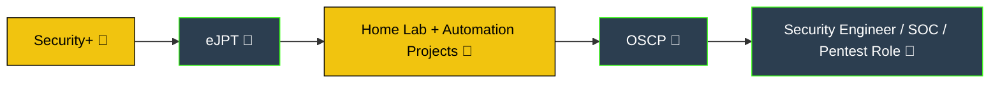

Here’s a fully customized version of the README tailored to **you (Hiruthik A)**. I’ve updated the name, role, interests, focus areas, and tone while keeping the strong cybersecurity aesthetic you liked.

Just replace `YOUR_USERNAME` with your actual GitHub username, and fill in the real links (LinkedIn, TryHackMe, etc.).

```markdown
<div align="center">
<!-- Animated header banner -->


<!-- Typing animation -->
<a href="#">
  
</a>

<br/>


[](#)
[](#)
[](#)
[](#)
</div>

---

### `> cat about_me.txt`

```yaml
name: Hiruthik A
role: B.Tech Cyber Security Engineering Student | Aspiring Security Engineer
location: /home/earth
current_focus: [Cybersecurity, Ethical Hacking, Networking, Secure Coding]
learning: [Python Automation, DevOps, Cloud Security, Detection Engineering]
fun_fact: "I break things to understand how to make them unbreakable."
```

<table>
<tr>
<td width="60%" valign="top">

### 🎯 Mission Briefing

I'm Hiruthik A, a B.Tech Cyber Security Engineering student passionate about the complete security lifecycle — from ethical hacking and networking to secure coding, automation, and modern DevOps practices.

I love learning by building and breaking things in controlled environments. My goal is to become a well-rounded security professional who understands both offensive techniques and defensive engineering.

- 🔐 Currently strengthening skills in **Ethical Hacking**, **Networking**, and **Secure Coding**
- 🧠 Actively practicing on **TryHackMe / HackTheBox** and participating in **CTFs**
- 🛠️ Building hands-on projects around **automation**, **cybersecurity tools**, and **DevOps**
- 📡 Exploring **Threat Intelligence**, **Network Defense**, and **Cloud Security**
- 🎓 Certification roadmap: `CompTIA Security+` → `eJPT` → `OSCP`

</td>
<td width="40%" valign="top">

```
┌─────────────────────────────┐
│   THREAT MODEL: SELF        │
├─────────────────────────────┤
│ Asset: Curiosity            │
│ Vector: Late-night labs     │
│ Mitigation: More coffee ☕  │
│ Status: UNPATCHED           │
└─────────────────────────────┘
```

</td>
</tr>
</table>

---

## 🛡️ Arsenal / Tech Stack

<div align="center">

**Offensive & Defensive Tooling**


**Languages & Scripting**


**Platforms & Infrastructure**


</div>

---

## ⚔️ Featured Operations (Projects)

<table>
<tr>
<td width="50%">

### 🕸️ Network Intrusion Detection Lab
Built a home SOC-style lab using **Suricata** + **ELK Stack** for real-time detection of port scans, brute-force attempts, and suspicious traffic patterns.

`Python` `Suricata` `ELK` `Docker`  
[**View Repo →**](#) &nbsp;|&nbsp; [**Write-up →**](#)

</td>
<td width="50%">

### 🐍 Automated Recon Framework
A modular Python tool that chains **Nmap**, **Subfinder**, and **Nikto** for automated attack-surface mapping and generates clean HTML reports.

`Python` `Bash` `Recon` `Regex`  
[**View Repo →**](#) &nbsp;|&nbsp; [**Write-up →**](#)

</td>
</tr>
<tr>
<td width="50%">

### 🔓 Intentionally Vulnerable Web App
Designed a Flask-based vulnerable application (SQLi, XSS, IDOR, broken authentication) used as a training range for peers.

`Flask` `SQLite` `OWASP Top 10`  
[**View Repo →**](#) &nbsp;|&nbsp; [**Write-up →**](#)

</td>
<td width="50%">

### 🧬 Static Malware Analyzer
Python tool that extracts PE headers, strings, and entropy scores to flag suspicious binaries before dynamic analysis.

`Python` `pefile` `YARA`  
[**View Repo →**](#) &nbsp;|&nbsp; [**Write-up →**](#)

</td>
</tr>
</table>

---

## 🚩 CTF & Range Progress

<div align="center">

| Platform     | Rank / Stats          | Focus Area                          |
|:------------:|:---------------------:|:------------------------------------|
| **TryHackMe**   | Top X% \| XX Rooms   | Web Exploitation, PrivEsc          |
| **HackTheBox**  | Hacker Rank          | Linux/Windows PrivEsc, AD          |
| **CTFtime**     | Team: `your_team`    | Web, Crypto, Forensics             |
| **PicoCTF**     | XX Challenges        | Binary Exploitation, Reverse Eng.  |

</div>

---

## 📊 Signal Intelligence (GitHub Stats)

<div align="center">


<br/>


</div>

---

## 🧭 Roadmap



---

## 📡 Establish Connection

<div align="center">

[](mailto:you@example.com)
[](#)
[](#)
[](#)

<br/>


**`> connection closed. session logged. stay curious.`**

</div>
```

### Quick next steps for you:
1. Replace every `YOUR_USERNAME` with your real GitHub username.
2. Update the badge links (LinkedIn, TryHackMe, HackTheBox, email, etc.).
3. Replace the project descriptions with your real projects (or keep these as placeholders until you build them).
4. Update the CTF stats table with your actual numbers.
5. Change the certification roadmap status if you’ve already completed any.

Would you like me to make any further changes (more DevOps focus, different colors, add more projects, change the year, etc.)?
